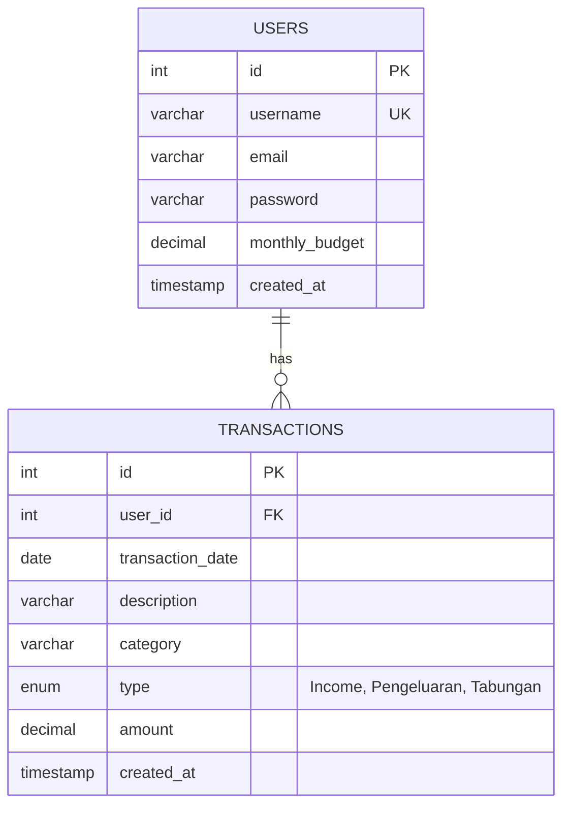

# 🎓 Student Money Tracker

[](https://www.php.net/)
[](https://www.mysql.com/)
[](https://developer.mozilla.org/)
[](LICENSE)
[]()

> **Aplikasi web pencatatan dan pengelolaan keuangan harian yang dirancang khusus untuk mahasiswa.**  
> Membantu memonitor alokasi bulanan, mencatat pemasukan, melacak pos pengeluaran berdasarkan kategori, serta mengontrol target tabungan secara *real-time* dan transparan.

---

## 📑 Daftar Isi
- [Ringkasan Proyek](#-ringkasan-proyek)
- [Fitur Utama](#-fitur-utama)
- [Arsitektur Sistem & Rekayasa Keamanan](#-arsitektur-sistem--rekayasa-keamanan)
- [Struktur Database (ERD)](#-struktur-database-erd)
- [Struktur Direktori Repositori](#-struktur-direktori-repositori)
- [Panduan Instalasi & Menjalankan Aplikasi](#-panduan-instalasi--menjalankan-aplikasi)
  - [Opsi A: Menggunakan XAMPP / Laragon](#opsi-a-menggunakan-xampp--laragon)
  - [Opsi B: Menggunakan PHP Built-in Server](#opsi-b-menggunakan-php-built-in-server)
- [Akun Percobaan (Demo Account)](#-akun-percobaan-demo-account)
- [Prinsip Rekayasa Perangkat Lunak](#-prinsip-rekayasa-perangkat-lunak)

---

## 💡 Ringkasan Proyek

Manajemen finansial merupakan salah satu tantangan terbesar bagi kalangan mahasiswa. Seringkali pengeluaran harian tidak terkontrol akibat ketiadaan alat pencatatan yang cepat, ringkas, dan bebas distraksi.

**Student Money Tracker** dibangun dengan prinsip efisiensi komputasi tinggi tanpa dependensi framework yang berat (*zero heavy external frameworks*). Menggunakan PHP murni (*Native PHP*) dan MySQL, aplikasi ini dapat di-deploy dengan cepat di berbagai lingkungan shared hosting, server kampus, maupun server lokal seperti XAMPP atau Docker.

---

## ✨ Fitur Utama

1. **🔐 Autentikasi Pengguna Mandiri**:
   - Pendaftaran akun baru (*Register*) dan verifikasi sandi aman (*Login*).
   - Pengamanan sesi terisolasi via *Session Guard* (`auth_check.php`).
2. **💰 Alokasi Budget Bulanan Fleksibel**:
   - Pemantauan alokasi uang saku/anggaran per bulan.
   - Modal interaktif untuk memperbarui target budget sewaktu-waktu.
3. **📊 Ringkasan Finansial 3 Dimensi**:
   - **Income (Pemasukan)**: Uang saku, gaji part-time, atau beasiswa.
   - **Pengeluaran**: Total biaya yang telah dihabiskan.
   - **Tabungan**: Nominal yang dialokasikan khusus untuk tabungan masa depan.
4. **🍩 Donut Chart Visualisasi Dinamis**:
   - Visualisasi distribusi pengeluaran berbasis CSS3 `conic-gradient` yang dihitung secara matematis dari agregasi database.
   - 5 kategori standar kebutuhan mahasiswa: *Kebutuhan Pokok*, *Kesehatan*, *Pendidikan*, *Hiburan*, dan *Lainnya*.
5. **📑 Buku Kas Transaksi Real-Time**:
   - Formulir pencatatan transaksi cepat dengan pemisahan kategori otomatis.
   - Tabel riwayat transaksi lengkap dengan format mata uang Rupiah (`Rp xxx.xxx`), label tipe transaksi berwarna, serta fungsi hapus data.

---

## 🛡️ Arsitektur Sistem & Rekayasa Keamanan

Aplikasi ini menerapkan standar rekayasa keamanan web fundamental:

| Aspek Keamanan | Implementasi Teknis | Mitigasi Risiko |
|:---|:---|:---|
| **SQL Injection** | Menggunakan *Parameterized Prepared Statements* (`$conn->prepare()`, `bind_param()`) di seluruh query | Mencegah eksploitasi injeksi SQL via input formulir |
| **Penyimpanan Password**| Algoritma satu arah bcrypt melalui `password_hash(..., PASSWORD_DEFAULT)` dan `password_verify()` | Mencegah kebocoran kredensial dalam bentuk plaintext |
| **Cross-Site Scripting (XSS)** | Sanitasi output HTML melalui fungsi `htmlspecialchars(..., ENT_QUOTES, 'UTF-8')` | Mencegah eksekusi script berbahaya pada deskripsi/username |
| **Session Fixation** | Panggilan `session_regenerate_id(true)` saat proses login berhasil | Melindungi ID sesi pengguna dari pembajakan |
| **Data Isolation** | Enforce klausul `WHERE user_id = ?` pada seluruh mutasi data (SELECT/INSERT/UPDATE/DELETE) | Mencegah *Insecure Direct Object Reference* (IDOR) |

---

## 🗄️ Struktur Database (ERD)



---

## 📂 Struktur Direktori Repositori

```text
student-money-tracker/
├── .gitignore                  # Berkas pengecualian Git (environment, OS temp, cache)
├── README.md                   # Dokumentasi teknis komprehensif
├── database.sql                # Skrip DDL MySQL & data seed siap import
├── config.php                  # Konfigurasi koneksi MySQL & sesi dengan fallback ENV
├── auth_check.php              # Middleware session verification guard
├── header.php                  # Template komponen navigasi & header atas
├── footer.php                  # Template penutup layout HTML
├── index.php                   # Dashboard analitik & transaksi dinamis utama
├── login.php                   # Halaman autentikasi masuk pengguna
├── register.php                # Halaman registrasi akun baru
├── logout.php                  # Handler destruksi sesi dan redirect
├── style.css                   # Stylesheet modern berbasis CSS Variables & Glassmorphism
└── studen money tracker.html   # Prototipe UI statis orisinal
```

---

## 🚀 Panduan Instalasi & Menjalankan Aplikasi

### Opsi A: Menggunakan XAMPP / Laragon

1. **Unduh Repositori**:
   Clone atau ekstrak repositori ini ke folder `htdocs` (XAMPP) atau `www` (Laragon):
   ```bash
   cd C:/xampp/htdocs
   git clone https://github.com/Deanovclla/student-money-tracker.git
   ```

2. **Impor Database**:
   - Buka **phpMyAdmin** (`http://localhost/phpmyadmin`).
   - Buat database baru bernama `keuangan_mahasiswa` (atau biarkan skrip membuat secara otomatis).
   - Masuk ke tab **Import**, pilih berkas [`database.sql`](database.sql), lalu klik **Go / Impor**.

3. **Konfigurasi Database (Jika Diperlukan)**:
   - Jika MySQL XAMPP Anda menggunakan password, sesuaikan kredensial di [`config.php`](config.php) atau tetapkan Environment Variable `DB_PASS`.

4. **Akses Aplikasi**:
   - Buka browser dan arahkan ke: `http://localhost/student-money-tracker`

---

### Opsi B: Menggunakan PHP Built-in Server

Pastikan PHP dan MySQL server telah terpasang dan berjalan:

```bash
# 1. Clone repositori
git clone https://github.com/Deanovclla/student-money-tracker.git
cd student-money-tracker

# 2. Impor database ke MySQL CLI
mysql -u root -p < database.sql

# 3. Jalankan development server
php -S localhost:8000
```
Buka peramban Anda di `http://localhost:8000`.

---

## 👤 Akun Percobaan (Demo Account)

Database [`database.sql`](database.sql) telah dilengkapi dengan akun demonstrasi untuk mempermudah evaluasi:

- **Username**: `mahasiswa_demo`
- **Password**: `password123`
*(Atau buat akun baru secara instan melalui halaman pendaftaran `register.php`)*.

---

## 📐 Prinsip Rekayasa Perangkat Lunak

- **Zero-Dependency Architecture**: Tidak memerlukan package manager (`npm` / `composer`) eksternal untuk berjalan, sehingga sangat tahan lama (*maintainable*) dan minim kerentanan supply-chain.
- **Responsive Layout**: Menggunakan CSS Grid dan Flexbox dengan media query untuk mendukung tampilan layar smartphone, tablet, maupun desktop monitor.
- **Graceful Fallbacks**: Visualisasi Donut Chart dan ringkasan transaksi memiliki fallback state yang anggun saat belum terdapat data transaksi yang tercatat.

---

<p align="center">
  Didesain untuk mendisiplinkan literasi finansial mahasiswa 🎓<br>
  <b>Open Source Project &copy; 2026</b>
</p>
